# POO: Atividade de Git

Demonstração do uso do **Git** para gerenciar versões de arquivos: criação de um
repositório público no GitHub, clonagem, versionamento com `add`/`commit`/`push`
e trabalho com um ramo (*branch*) separado.

**Autora:** Anna Carolina Limonta, Engenharia de Computação (UFG)

---

## Resumo das etapas e dos comandos

| Etapa                        | Comandos Git utilizados |
|------------------------------|-------------------------|
| 1. Criação do repositório    | `gh repo create POO --public --add-readme` (GitHub CLI) |
| 2. Clonagem                  | `git clone https://github.com/annalimonta/POO.git`, `git remote -v`, `git log --oneline`, `git config user.name` / `user.email` |
| 3. Edição e versionamento    | `git status`, `git add comandos-git.md`, `git commit -m "..."`, `git push origin main` |
| 4. Criação e troca de ramo   | `git branch`, `git switch -c desenvolvimento`, `git diff`, `git add`, `git commit -m "..."`, `git push -u origin desenvolvimento`, `git branch -a`, `git log --oneline --graph --all` |

O arquivo versionado é o [`comandos-git.md`](comandos-git.md), um resumo dos
comandos usados. Ele foi criado no ramo `main` e ganhou uma seção nova no ramo
[`desenvolvimento`](https://github.com/annalimonta/POO/blob/desenvolvimento/comandos-git.md).

> Observação: as linhas `warning: ... LF will be replaced by CRLF` que aparecem
> em alguns prints são apenas um aviso do Git no Windows sobre o formato de fim de
> linha dos arquivos. Não são erros.

---

## 1. Criação do repositório

O repositório público **POO** foi criado na minha conta pelo GitHub CLI. O
parâmetro `--public` define a visibilidade pública, e `--add-readme` já cria um
`README.md` inicial, gerando o primeiro commit (*Initial commit*).

```powershell
gh repo create POO --public --add-readme --description "Atividade de Git: versionamento de arquivos, ramos e envio ao GitHub"
```

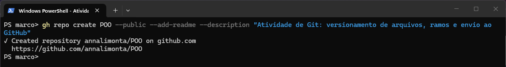

Logo após a criação, o GitHub já mostra o repositório **Public**, com o ramo
`main`, 1 branch e 1 commit:

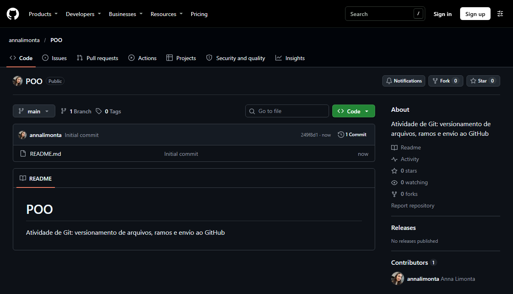

---

## 2. Clonagem

Com `git clone`, o repositório remoto foi copiado para o computador. A cópia
local tem a pasta oculta `.git`, que guarda todo o histórico, e o `README.md`.
O `git remote -v` mostra que a cópia está ligada ao GitHub com o nome `origin`,
e o `git log --oneline` mostra o commit inicial que veio junto.

Por fim, configurei o nome e o e-mail que identificam a autora dos commits neste
repositório.

```powershell
git clone https://github.com/annalimonta/POO.git
cd POO
ls -Force
git remote -v
git log --oneline
git config user.name "Anna Limonta"
git config user.email "244000689+annalimonta@users.noreply.github.com"
```

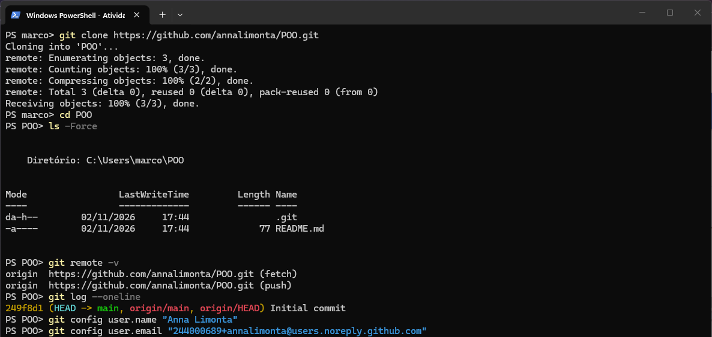

---

## 3. Edição e versionamento (`add`, `commit` e `push`)

Criei o arquivo `comandos-git.md` e registrei a alteração:

1. `git status`: o arquivo aparece como **não rastreado** (*untracked*), em vermelho.
2. `git add comandos-git.md`: o arquivo vai para a área de preparação (*stage*).
   O `git status --short` passa a mostrar `A` (*added*).
3. `git commit -m "Adiciona resumo dos comandos Git basicos"`: registra a
   alteração no histórico local, no commit `f006231`. O parâmetro `--trailer`
   acrescenta à mensagem uma linha de coautoria.
4. `git push origin main`: envia o commit ao GitHub (`249f8d1..f006231  main -> main`).
5. `git log --oneline`: o histórico agora tem 2 commits, e `main` e `origin/main`
   apontam para o mesmo commit.

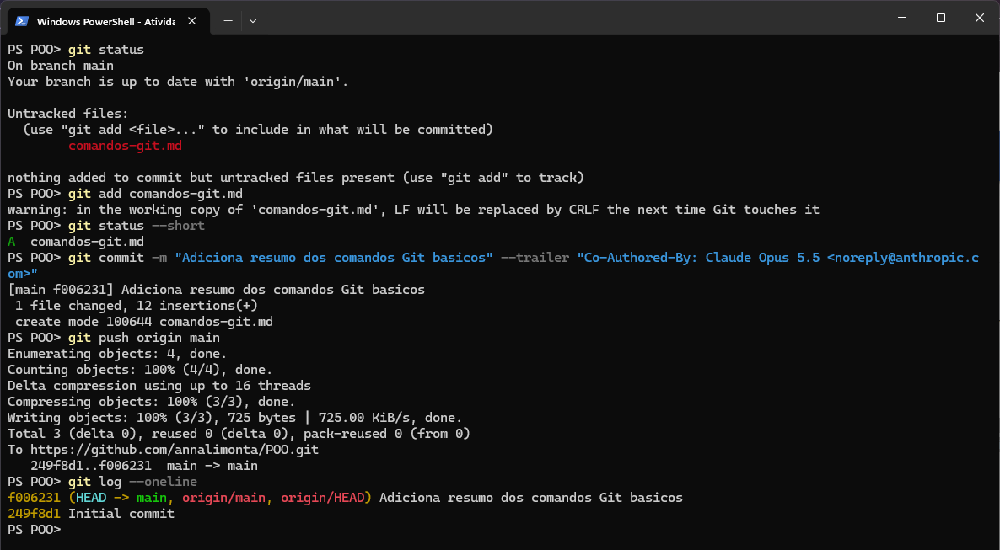

---

## 4. Criação e alteração de ramo (*branch*)

### 4.1 Criar o ramo, alternar para ele e modificar o arquivo

1. `git branch`: inicialmente existe só o ramo `main` (o atual tem `*`).
2. `git switch -c desenvolvimento`: cria o ramo **`desenvolvimento`** e já alterna
   para ele (*Switched to a new branch*).
3. `git branch`: agora existem dois ramos, e o atual é `desenvolvimento`.
4. Modifiquei o `comandos-git.md`, acrescentando a seção **Ramos (branches)**.
   O `git status --short` mostra o arquivo como `M` (*modified*), e o `git diff`
   mostra em verde as linhas acrescentadas.

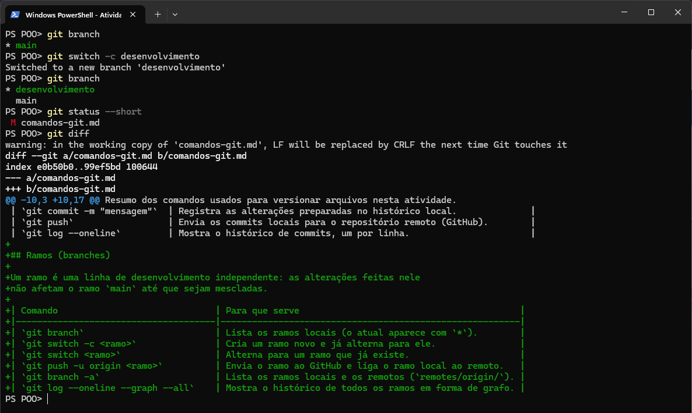

### 4.2 Novo commit no ramo e envio ao GitHub

1. `git add` e `git commit -m "Adiciona secao sobre comandos de ramos"`: o commit
   `05cc9d9` é criado **no ramo `desenvolvimento`** (`[desenvolvimento 05cc9d9]`).
2. `git push -u origin desenvolvimento`: envia o ramo ao GitHub, que responde com
   `* [new branch] desenvolvimento -> desenvolvimento`. O `-u` liga o ramo local
   ao remoto (*set up to track 'origin/desenvolvimento'*).
3. `git branch -a`: lista os ramos locais (`desenvolvimento`, `main`) e os
   remotos (`remotes/origin/desenvolvimento`, `remotes/origin/main`).
4. `git log --oneline --graph --all`: o ramo `desenvolvimento` está **um commit à
   frente** do `main`. O commit `05cc9d9` existe só nele.

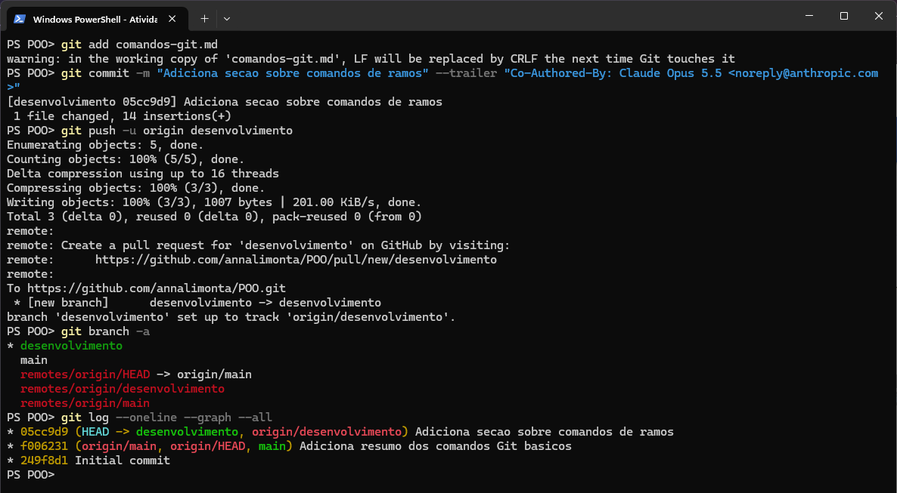

---

## 5. Evidências no GitHub

### Página do repositório

O repositório mostra **2 Branches** e, no ramo `main`, **2 Commits**, com os
arquivos `README.md` e `comandos-git.md`.

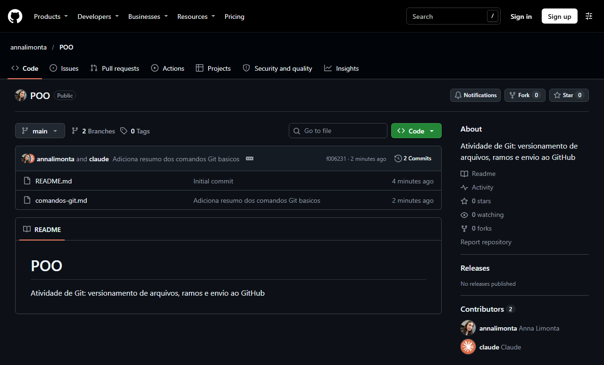

### Ramos existentes no GitHub

Na página [Branches](https://github.com/annalimonta/POO/branches) aparecem o
ramo padrão `main` e o ramo `desenvolvimento`, que está **0 commits atrás e 1
à frente** (*Behind 0 | Ahead 1*) do `main`.

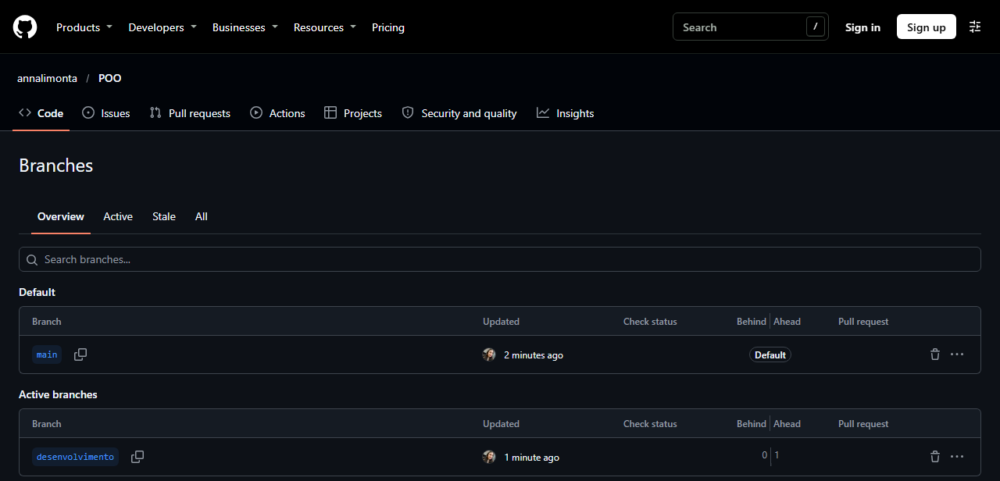

### Histórico de commits do ramo `main`

[Commits do `main`](https://github.com/annalimonta/POO/commits/main): o
*Initial commit* da criação do repositório e o commit
*Adiciona resumo dos comandos Git basicos*.

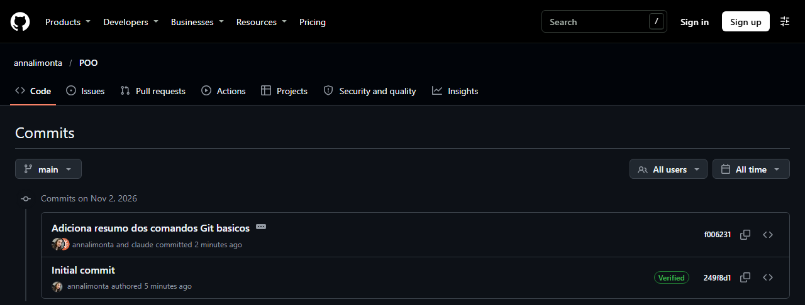

### Histórico de commits do ramo `desenvolvimento`

[Commits do `desenvolvimento`](https://github.com/annalimonta/POO/commits/desenvolvimento):
os mesmos dois commits do `main` e, acima deles, o commit
*Adiciona secao sobre comandos de ramos*, feito só neste ramo.

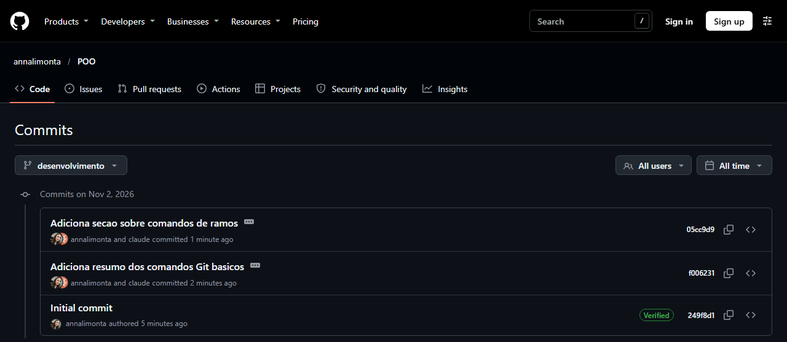

### Comparação entre os ramos

A [comparação `main...desenvolvimento`](https://github.com/annalimonta/POO/compare/main...desenvolvimento)
mostra a diferença entre os ramos: 1 commit e 1 arquivo alterado, com 14 linhas
acrescentadas no `comandos-git.md`.

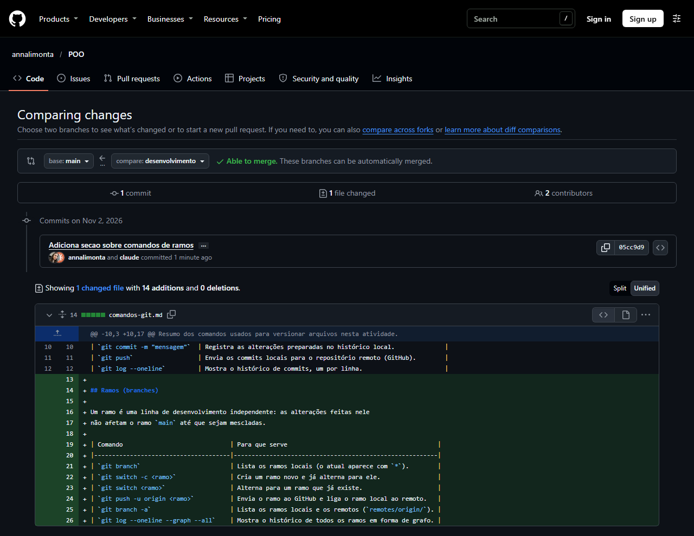

---

## Estado final do histórico

```
* 05cc9d9 (desenvolvimento, origin/desenvolvimento) Adiciona secao sobre comandos de ramos
* f006231 (main, origin/main) Adiciona resumo dos comandos Git basicos
* 249f8d1 Initial commit
```

Depois dos prints acima, este relatório (`README.md`) e a pasta `prints/` foram
publicados em mais um commit no ramo `main`. O ramo `desenvolvimento` foi mantido
separado, sem mesclar, para mostrar os dois ramos no GitHub.
